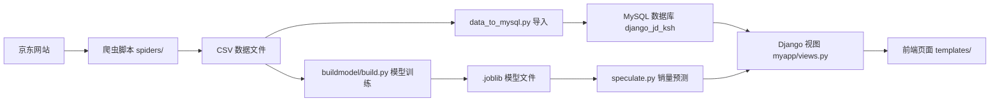

# 京东商品数据分析与销量预测系统

> 一个基于 **Django + MySQL** 的京东商品数据可视化分析平台：
> **爬取数据 → 存入数据库 → 图表分析 → 机器学习预测销量**，一站式完成。

本项目为学习项目，完整复现了"爬虫 → 数据入库 → Web 展示 → 可视化 → 机器学习"的全流程开发。

---

## 一、项目能做什么？

| 功能 | 说明 | 访问地址 |
|---|---|---|
| 用户系统 | 注册 / 登录 / 登出（Django 认证体系） | `/register/` `/login/` `/logout/` |
| 系统主页 | 数据总览仪表盘（图表汇总） | `/index/` |
| 商品列表 | 商品信息分页浏览 | `/ecommerce_products/` |
| 商品详情 | 单个商品的详细信息 + 精选评论 | `/ecommerce_products_details/` |
| 评论列表 | 商品评论分页浏览 | `/ecommerce_comment_list/` |
| 整体分析 | 商品数据多维度图表（ECharts） | `/entirety_chart/` |
| 相关性分析 | 价格/评分等指标相关性图表（ApexCharts） | `/relativity_chart/` |
| 评论词云 | jieba 中文分词 + 词频统计 + 词云图 | `/comment_chart/` |
| 销量预测 | 输入价格/品牌/好评率/平均分，随机森林模型预测销量区间 | `/sale_data_predict/` |
| 个人中心 | 查看/修改个人信息、修改密码 | `/user_profile_admin/` `/reset_password/` |
| 权限演示 | 后台分组权限（编辑组可见文章列表，无权限返回 403） | `/articles/` |
| 管理后台 | Django Admin，直接对数据表增删改查 | `/admin/` |

---

## 二、技术栈

| 层次 | 技术 |
|---|---|
| 后端框架 | Django 5.2（Python 3.12） |
| 数据库 | MySQL（PyMySQL 驱动） |
| 数据处理 | pandas、NumPy、SQLAlchemy |
| 爬虫 | requests、selenium、lxml、fake-useragent |
| 中文分词 | jieba |
| 机器学习 | scikit-learn（随机森林 / 逻辑回归）、joblib |
| 前端 | Bootstrap（Rocker 模板）、ECharts、echarts-wordcloud、ApexCharts |

---

## 三、系统架构与数据流



**一句话理解**：爬虫把京东商品和评论抓下来存成 CSV → 导入脚本把 CSV 写进 MySQL → Django 从数据库读数据渲染成网页图表 → 训练脚本用 CSV 训练机器学习模型 → 预测页面调用模型给出销量区间。

---

## 四、目录结构

```
jd_djangoProject/
├── manage.py                  # Django 命令行入口（迁移、启动都靠它）
├── requirements.txt           # Python 依赖清单
├── speculate.py               # 加载训练好的模型，执行销量预测
├── jd_djangoProject/          # 项目配置目录
│   ├── settings.py            # ★ 全局配置（数据库、静态文件、登录等）
│   └── urls.py                # 总路由（admin/ + 转发到 myapp）
├── myapp/                     # ★ 核心应用
│   ├── models.py              # 数据模型：User / XinXi商品 / Comment评论 / Article
│   ├── views.py               # 所有页面的后端逻辑
│   ├── urls.py                # 页面路由表
│   ├── admin.py               # Admin 后台注册
│   └── migrations/            # 数据库迁移文件（表结构的"版本记录"）
├── templates/                 # ★ 前端页面（均继承 base.html）
│   ├── base.html              # 公共骨架：侧边栏导航 + 顶栏
│   ├── login.html / register.html / index.html ...
│   └── 403.html               # 无权限提示页
├── spiders/                   # ★ 爬虫与数据
│   ├── spider3.py             # 商品信息爬虫（产出 result3.csv）
│   ├── UrlComments.py         # 评论解析脚本（产出 comments.csv）
│   ├── data_to_mysql.py       # ★ CSV → MySQL 导入脚本
│   ├── result3.csv            # 商品数据（已随仓库提供）
│   ├── comments.csv           # 评论数据（已随仓库提供）
│   └── ipdaili.txt            # 代理 IP 列表
├── buildmodel/                # ★ 机器学习
│   ├── build.py               # 模型训练脚本
│   ├── random_forest_sales_model.joblib    # 随机森林模型（已训练）
│   ├── logistic_regression_sales_model.joblib
│   └── *.joblib               # 品牌/销量区间标签编码器
├── static/assets/             # 静态资源（CSS/JS/图片，Rocker 模板）
├── avatars/                   # 用户上传的头像（MEDIA_ROOT）
└── 项目流程文档.txt            # ★ 从零复现本项目的详细开发笔记
```

---

## 五、设计过程（本项目是怎么一步步做出来的）

按开发顺序共 9 个阶段，详细操作见 `项目流程文档.txt`：

1. **搭建骨架**：PyCharm 创建 Django 项目 + 虚拟环境，注册 `myapp`，配置 MySQL 替代默认 sqlite3。
2. **用户系统**：定义 `User` 模型（继承 `AbstractUser` 接入 Django 认证），实现登录/注册/登出，前端基于 Rocker 模板改造。
3. **页面框架**：把模板首页拆成 `base.html`（导航骨架）+ `index.html`（继承骨架的主页图表），后续所有页面都继承 base。
4. **数据采集**：准备代理 IP → `spider3.py` 爬商品信息 → `UrlComments.py` 解析评论 → 得到 `result3.csv` 和 `comments.csv`。
5. **数据入库**：定义 `XinXi`（商品）、`Comment`（评论）模型，migrate 建表，`data_to_mysql.py` 把 CSV 写入 MySQL。
6. **商品页面**：商品列表（分页）、商品详情（随机精选评论）、评论列表。
7. **可视化**：整体分析（ECharts）、相关性分析（ApexCharts）、评论词云（jieba 分词 + Counter 词频 + echarts-wordcloud）。
8. **销量预测**：`build.py` 用"价格/品牌/好评率/平均分"4 个特征训练随机森林和逻辑回归模型并保存为 .joblib；`speculate.py` 加载模型预测；前端表单提交 → 后端校验 → 调用模型 → 返回销量区间。
9. **权限管理**：个人信息/修改密码页（`@login_required`），Article 文章表 + 自定义权限 `can_publish`（`@permission_required`），后台分组控制可见性，无权限跳自定义 403 页面。

---

## 六、部署与运行教学（从零到能访问）

### 环境要求

- Python 3.10+（本项目使用 3.12）
- MySQL 8.x（本地 3306 端口）
- 可选：Navicat / SQLyog 等数据库可视化工具

### 第 1 步：安装依赖

```powershell
cd D:\work\code\Jd\jd_djangoProject
python -m venv .venv
.venv\Scripts\Activate.ps1
pip install -r requirements.txt
```

### 第 2 步：创建数据库（⚠️ 最容易踩的坑）

Django **不会自动创建数据库**，必须手动建库。

> ⚠️ 注意：在 Navicat 里"新建连接"**不等于**"新建数据库"！
> 连接只是通往 MySQL 服务器的通道，要在连接上**右键 → 新建数据库**。

执行 SQL（或在 Navicat 中新建数据库）：

```sql
CREATE DATABASE django_jd_ksh DEFAULT CHARACTER SET utf8mb4 COLLATE utf8mb4_unicode_ci;
```

### 第 3 步：配置数据库账号

编辑 `jd_djangoProject/settings.py` 的 `DATABASES`，把 `PASSWORD` 改成你自己的 MySQL 密码：

```python
DATABASES = {
    'default': {
        'ENGINE': 'django.db.backends.mysql',
        'NAME': 'django_jd_ksh',
        'USER': 'root',
        'PASSWORD': '<你的MySQL密码>',
        'HOST': 'localhost',
        'PORT': '3306',
    }
}
```

同时修改 `spiders/data_to_mysql.py` 中的连接串：

```python
engine = create_engine("mysql+pymysql://root:<你的MySQL密码>@localhost:3306/django_jd_ksh?charset=utf8mb4")
```

> ⚠️ 密码若含 `@`、`:`、`/` 等特殊字符，在 URL 连接串中必须转义（如 `@` 写成 `%40`），
> 否则会被错误解析导致连接失败。**建议直接使用纯字母数字密码**，可避免此类问题。

### 第 4 步：迁移建表

```powershell
python manage.py migrate
```

看到一连串 `Applying ... OK` 即成功。此时数据库里会出现
`myapp_user`、`myapp_xinxi`、`myapp_comment`、`myapp_article` 及 Django 系统表。

> 表结构由 migrate 创建，**不是**在 Navicat 里手动导入的。

### 第 5 步：导入商品/评论数据

CSV 已随仓库提供，无需重新爬取。**必须在 spiders 目录下运行**（脚本用相对路径读 CSV）：

```powershell
cd spiders
python data_to_mysql.py
cd ..
```

> ⚠️ 脚本使用 `if_exists='replace'`，会**删除并重建**商品表和评论表，导入一次即可，勿反复执行。

### 第 6 步：创建管理员并启动

```powershell
python manage.py createsuperuser   # 按提示设置账号密码
python manage.py runserver 8000
```

浏览器访问：

- 前台：<http://127.0.0.1:8000/>（先注册普通用户，或用超级用户登录）
- 后台：<http://127.0.0.1:8000/admin/>

### 日常启动（已完成部署后）

```powershell
cd D:\work\code\Jd\jd_djangoProject
.venv\Scripts\Activate.ps1
python manage.py runserver 8000
```

---

## 七、进阶操作（可选）

### 重新爬取数据

1. 登录京东网页版，F12 → 网络 → 复制请求头中的 Cookie，填入 `spiders/spider3.py`。
2. 准备代理 IP（`spiders/ipdaili.txt`）。
3. 按脚本内注释分两步运行（先 `pinpai` 后 `data`），产出 `result3.csv`。
4. 评论：手动访问京东评论接口 URL，把返回 JSON 粘贴到 `CopyComments.json`，运行 `UrlComments.py` 生成 `comments.csv`。
5. 再执行第 5 步导入。

> 请遵守目标网站 robots 协议，控制频率，仅供学习使用。

### 重新训练预测模型

```powershell
cd buildmodel
python build.py
```

流程：读取 result3.csv → 定义销量区间 → 特征编码 → 划分训练/测试集 → 训练随机森林与逻辑回归 → 保存 .joblib → 输出准确率。

### 权限功能体验

1. 超级用户登录 `/admin/`，创建分组（如"编辑组"），赋予 `myapp | article | can_publish` 权限，把某用户加入该组。
2. 该用户登录后访问 `/articles/` 可见文章列表；无权限用户访问则看到自定义 403 页面。

---

## 八、常见问题（FAQ）

| 报错/现象 | 原因 | 解决 |
|---|---|---|
| `(1049, "Unknown database 'django_jd_ksh'")` | 数据库不存在（Navicat 只建了连接没建库） | 见第 2 步，真正创建数据库 |
| `(1045, "Access denied ...")` | 密码错误，或改过 MySQL 密码后配置未同步 | 核对 settings.py 与导入脚本中的密码 |
| 导入脚本报连接错误，但 Django 能连上 | URL 连接串中密码含 `@` 未转义 | 转义为 `%40` 或改用纯字母数字密码 |
| 库存在但没有任何表 | 未执行 migrate | `python manage.py migrate` |
| 导入脚本找不到 result3.csv | 运行目录不对 | 先 `cd spiders` 再运行 |
| 页面图表空白 | 数据库没数据 | 执行第 5 步导入 CSV |
| 详情页评论不显示 | comment_date 类型问题 | 使用仓库自带的 data_to_mysql.py（已修复时区处理） |

---

## 九、安全与声明

- 本项目为**学习项目**：`SECRET_KEY`、`DEBUG=True`、数据库口令均为开发配置，**勿直接部署上线**。
- 提交公开仓库前请确认：爬虫脚本中**不含真实京东 Cookie**、配置中不含真实密码。
- 数据来源于公开页面抓取，仅用于学习交流，请遵守目标网站协议。

---

## 十、延伸阅读

- `项目流程文档.txt`：从零复现本项目的完整开发笔记（含每一步操作细节）。
- 各源码文件内附有详细中文注释，适合初学者逐行阅读。